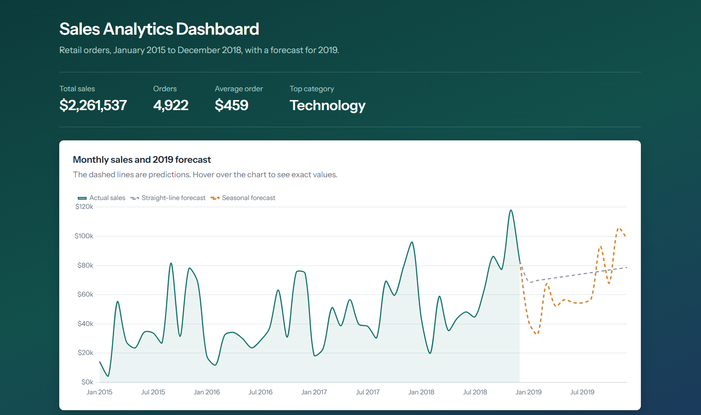
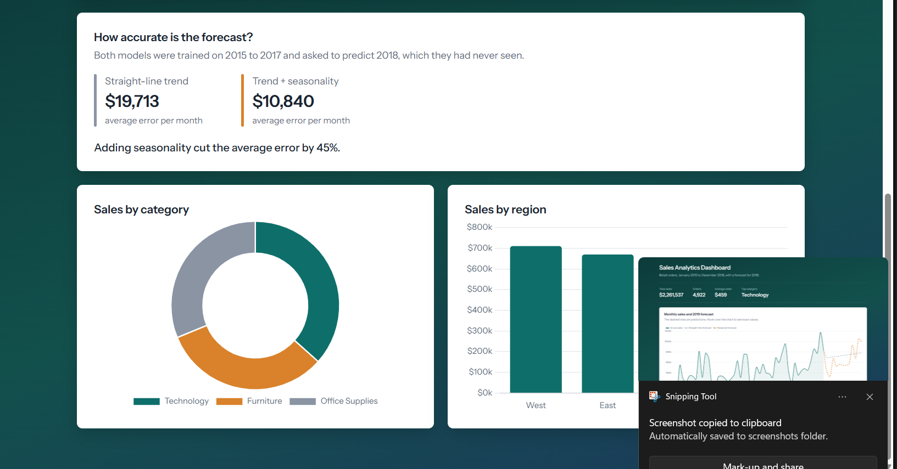

# Sales Analytics Dashboard

A web dashboard that turns raw retail sales data into charts and a 12-month sales forecast.




## What it does
- Cleans 9,800 rows of retail order data with pandas (date parsing, duplicate checks)
- Serves the results through a Flask REST API
- Shows KPIs, monthly sales, sales by category and region with Chart.js
- Forecasts 2019 sales with linear regression, comparing two models on a held-out year

## Forecast results
Both models were trained on 2015-2017 and tested on 2018, which they had not seen.

| Model | Average error per month |
|---|---|
| Straight-line trend | $19,713 |
| Trend + month-of-year seasonality | $10,840 |

Adding seasonality reduced the error by 45%. The model is still simple: it has only
four years of data and cannot predict one-off events.

## API endpoints
| Endpoint | Returns |
|---|---|
| `/api/summary` | Total sales, orders, average order value, top category |
| `/api/sales/monthly` | Monthly sales totals |
| `/api/sales/by-category` | Sales per category |
| `/api/sales/by-region` | Sales per region |
| `/api/forecast` | 12-month forecast from both models, with error metrics |

## Tech stack
Python, pandas, NumPy, scikit-learn, Flask, JavaScript, Chart.js

## How to run
```
pip install -r requirements.txt
python app.py
```
Then open http://127.0.0.1:5000/

## Dataset
Superstore sales data from Kaggle (rohitsahoo/sales-forecasting).